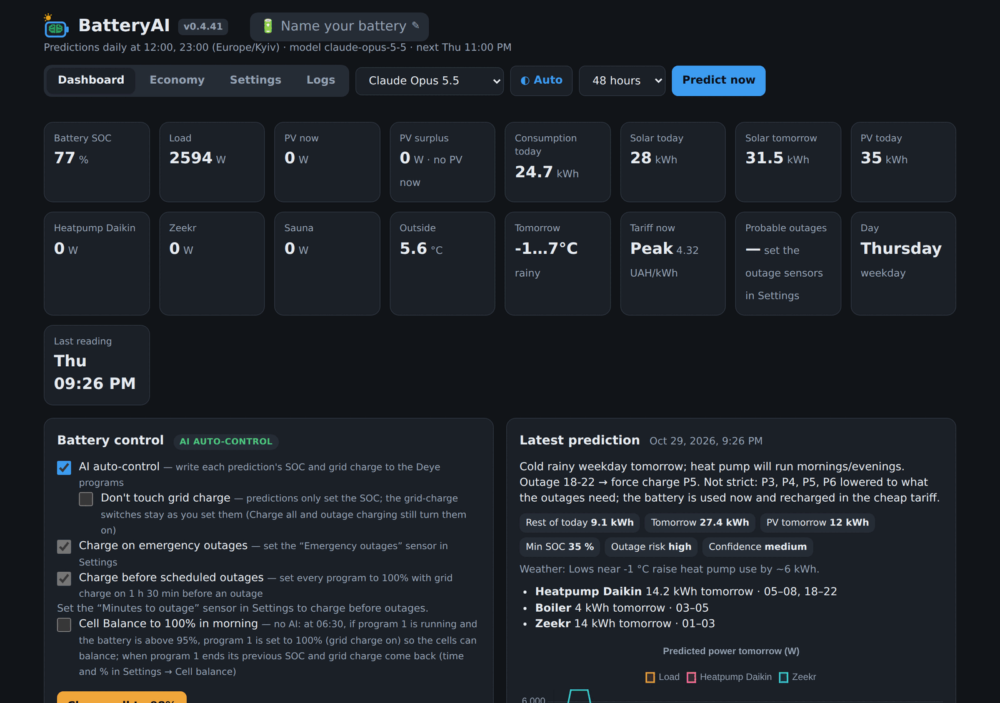
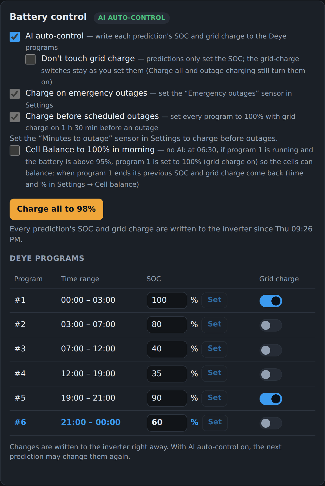
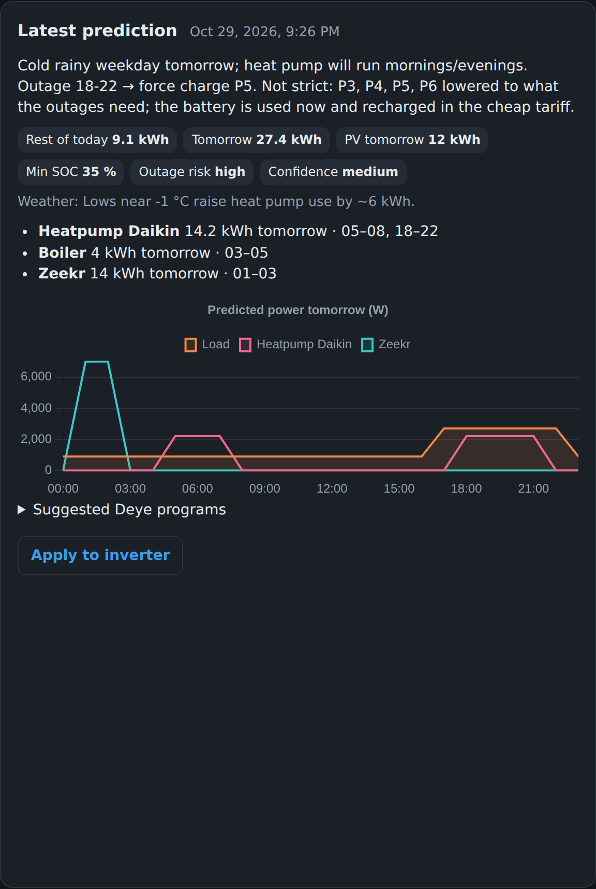
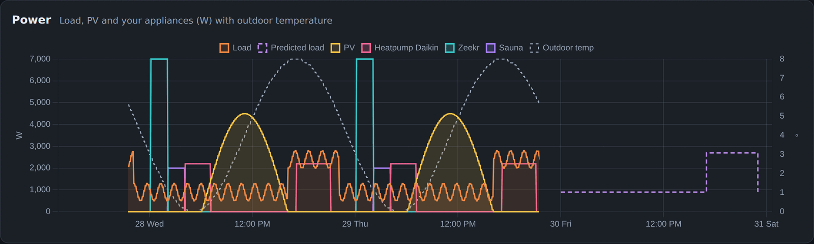
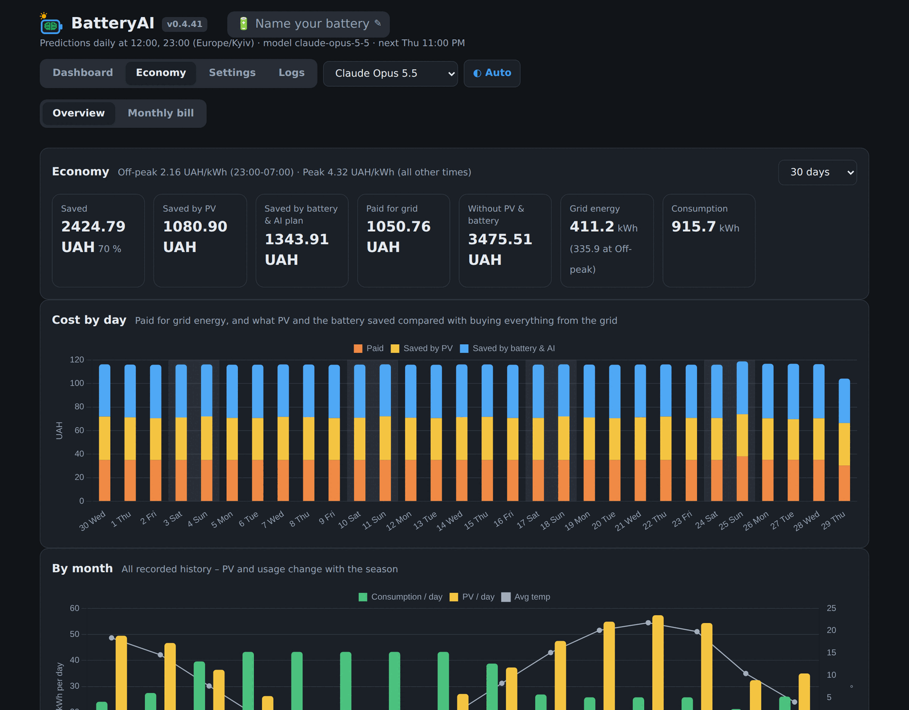
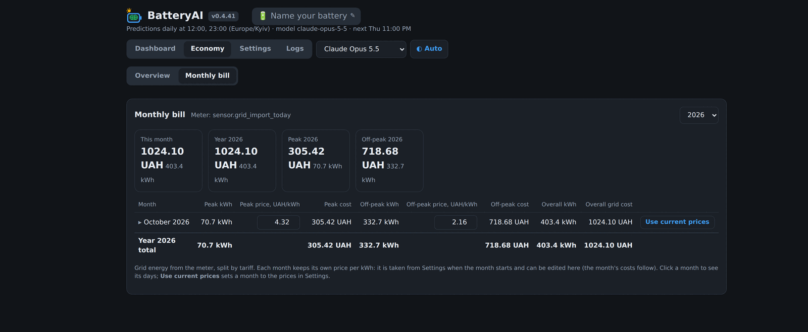
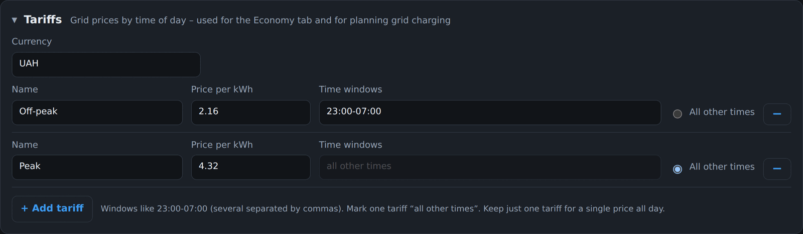
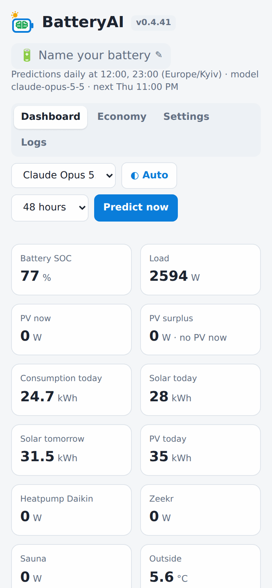

# BatteryAI – розумне планування батареї для інверторів Deye у Home Assistant

[English](README.md) · **Українська**

BatteryAI – це аддон Home Assistant для будинків із сонячними панелями, батареєю та
**гібридним інвертором Deye**. Він записує дані про батарею, сонце, навантаження,
прилади, погоду, тарифи та відключення. На їх основі він прогнозує споживання й
виробіток сонця та планує **SOC і заряд від мережі для шести програм інвертора за
часом (time-of-use)**. Коли увімкнено AI auto-control, план записується в інвертор
автоматично: у заплановані години прогнозу (за замовчуванням 12:00 і 23:00) і щоразу,
коли наближається відключення.



## Що він робить

- **Прогнозує** споживання, виробіток сонячних панелей і найнижчий рівень заряду батареї.
  Враховує всю записану історію, будні й вихідні, прогноз погоди та пору року.
- **Планує шість програм Deye**: SOC для кожного проміжку часу й чи вмикати заряд від
  мережі. Батарея заряджається за найдешевшим тарифом, сонце використовується першим, а
  на відключення лишається достатній запас.
- **Керує інвертором** (за бажанням): кожен прогноз записується в інвертор. SOC і заряд
  від мережі кожної програми можна змінити й вручну на панелі.
- **Відключення**:
  - заряджає батарею перед плановими відключеннями за датчиком «хвилин до відключення»;
  - одразу заряджає під час аварійних відключень;
  - за датчиком стану мережі вчиться, о котрій зазвичай бувають відключення.
- **Тарифи**: будь-яка кількість тарифів із назвами, власними цінами та проміжками часу
  (наприклад, нічний 23:00–07:00 і денний) або одна ціна на весь день.
- **Економія**:
  - скільки заплачено за електроенергію з мережі;
  - скільки заощадили сонце й батарея;
  - місячний рахунок за тарифами та вартість кожного приладу.
- **Сповіщення на телефон** через застосунок Home Assistant Companion. Кожне починається
  з короткого підсумку; потягніть його вниз, щоб побачити всі програми. Кнопка відкриває
  BatteryAI.
- **Чотири рушії прогнозу**:
  - Claude і ChatGPT (хмара, ваш API-ключ);
  - *Local fast* – статистика й правила, без інтернету;
  - *Local slow* – невелика мовна модель, що працює всередині аддона.

## Знімки екрана

| Керування батареєю | Останній прогноз |
| --- | --- |
|  |  |

**Графік потужності** – навантаження, сонце, прилади, температура надворі та
прогнозоване навантаження:



**Економія** – скільки заощаджено завдяки сонцю та завдяки батареї й плану ШІ:



**Місячний рахунок** – енергія з мережі та вартість за кожним тарифом:



| Тарифи | Телефон |
| --- | --- |
|  |  |

## Що потрібно

- **Home Assistant OS або Supervised.** Аддони працюють лише в них. Підтримуються aarch64
  (наприклад, Raspberry Pi 4/5) та amd64.
- **Гібридний інвертор Deye у Home Assistant, програми якого можна змінювати**,
  наприклад через інтеграцію Solarman. Для кожної з 6 програм потрібні:
  - сутність часу;
  - сутність SOC (number, input_number або select);
  - за бажанням – перемикач заряду від мережі або select джерела заряду.
- **Датчики**: SOC батареї, потужність навантаження та сонця. Дуже бажано мати прогноз
  сонця (наприклад, Solcast або Forecast.Solar) і сутність `weather.*`.
- **Для Claude або ChatGPT**: API-ключ з console.anthropic.com або platform.openai.com,
  оплата за кожен запит. Локальним рушіям ключ та інтернет не потрібні.

## Встановлення

1. У Home Assistant відкрийте **Settings → Add-ons → Add-on store**.
2. Меню (⋮) → **Repositories** → додайте `https://github.com/denveronly/batteryai`.
3. Встановіть **BatteryAI** і запустіть його. Увімкніть **Show in sidebar**.
4. Відкрийте **BatteryAI** у бічній панелі та перейдіть на вкладку **Settings**.

## Перше налаштування

1. **Sensors**: вкажіть свої сутності. Біля кожного поля є кнопка **Test**: вона показує
   поточне значення або пояснює, чому його не вдається прочитати.
2. **Deye programs**: сутності часу, SOC і заряду від мережі для кожної з 6 програм.
   Програма діє від свого часу до часу наступної програми; P6 діє до P1.
3. **Tariffs**: валюта, ціни та проміжки часу (**+ Add tariff**). Для однієї ціни на
   весь день залиште один тариф.
4. **Prediction engine**: оберіть Claude, ChatGPT, Local fast або Local slow. Для хмарних
   рушіїв вставте API-ключ і натисніть **Test**.
5. **Phone notifications**: оберіть свій телефон (`mobile_app_…`) і надішліть тестове
   сповіщення.
6. **Save settings**. Історія імпортується з recorder Home Assistant, тому графіки й
   прогнози працюють одразу.
7. На вкладці **Dashboard** натисніть **Predict now** і перевірте план. Коли він вас
   влаштовує, увімкніть **AI auto-control**.

## Рушії прогнозу

| Рушій | Де працює | Швидкість | Примітки |
| --- | --- | --- | --- |
| Claude | хмара Anthropic, API-ключ | ~1 хв | Аналізує всю історію, погоду, відключення й тарифи |
| ChatGPT | хмара OpenAI, API-ключ | ~1 хв | Ті самі дані, інструкції та формат відповіді, що й у Claude |
| Local fast | всередині аддона | миттєво | Прогноз за схожими днями та фіксовані правила; без інтернету |
| Local slow | всередині аддона (llama.cpp) | хвилини, ~3 ГБ RAM | Мовна модель Qwen2.5 3B; модель (~2 ГБ) завантажується один раз |

## Безпека

- BatteryAI записує в інвертор лише в таких випадках:
  - увімкнено **AI auto-control**;
  - натиснуто **Apply to inverter** або **Charge all**;
  - ви змінюєте програму вручну;
  - спрацьовує захисне правило, яке ви увімкнули в Battery control: *Charge on emergency
    outages*, *Charge before scheduled outages* або *Cell Balance to 100% in morning*.
- Змінюються лише **SOC і заряд від мережі** кожної програми. Час програм і заряд від
  генератора BatteryAI не змінює ніколи.
- Кожен запис враховує min/max/step самої сутності та діапазон SOC з *Prediction tuning*.
  Він потрапляє в журнал аналізів і може надсилатися на телефон.
- Якщо аддон зупиниться, інвертор продовжить працювати за останніми програмами.

## Дані та резервна копія

Усі дані лишаються у вашому Home Assistant, у базі SQLite в каталозі `/data`. Старі
показники стискаються до погодинних значень, тому рік даних займає лише кілька МБ.
**Logs → Backup** завантажує zip-архів із базою та налаштуваннями й дає змогу відновити
його в новій установці. В архіві є ваші API-ключі, тож не передавайте його стороннім.

## Документація

- [batteryai/DOCS.md](batteryai/DOCS.md) описує кожен параметр і правило (англійською).
  Той самий опис є на вкладці **Documentation** аддона.
- [batteryai/CHANGELOG.md](batteryai/CHANGELOG.md) містить зміни в кожній версії.

## Структура репозиторію

```
repository.yaml            метадані репозиторію аддонів
docs/screenshots/          зображення для цього README
batteryai/
  config.yaml              маніфест аддона (версія, ingress, архітектури)
  build.yaml, Dockerfile   збірка контейнера (Python 3.12, llama.cpp для локальної моделі)
  DOCS.md, CHANGELOG.md    документація та список змін
  app/
    main.py                вебсервер, запис даних, розклад прогнозів, HTTP API
    config.py              перевірка й збереження налаштувань (/data/settings.json)
    collector.py           читає налаштовані сутності Home Assistant
    ha.py                  REST-клієнт Home Assistant (через Supervisor)
    db.py                  база SQLite, денні й місячні підсумки, економія, точність
    history.py             імпорт минулих значень із recorder Home Assistant
    planning.py            правила планування, спільні для всіх рушіїв
    analyzer.py            вхідні дані, інструкції та схема відповіді для Claude
    openai_engine.py       рушій ChatGPT (OpenAI Chat Completions)
    local_fast.py          локальний рушій: прогноз за схожими днями та правила
    local_llm.py           локальний рушій: Qwen2.5 3B через llama.cpp
    llm_worker.py          запускає один запит до локальної моделі в окремому процесі
    control.py             записує SOC і заряд від мережі в програми Deye
    outage_plan.py         заряд перед відключенням з урахуванням тарифів
    grid.py                наявність мережі та історія відключень
    balance.py             ранкове балансування комірок до 100%
    bill.py                місячний рахунок за лічильником енергії з мережі
    backup.py              резервна копія та відновлення /data
    notify.py              сповіщення на телефон
    static/                інтерфейс панелі (Dashboard, Economy, Settings, Logs; вбудований Chart.js)
```

## Локальна розробка

```sh
cd batteryai/app
pip install -r ../requirements.txt
mkdir -p dev-data && export BATTERYAI_DATA=$PWD/dev-data
export HA_URL=http://homeassistant.local:8123 HA_TOKEN=<довгостроковий токен доступу>
python main.py   # інтерфейс на http://localhost:8099
```
